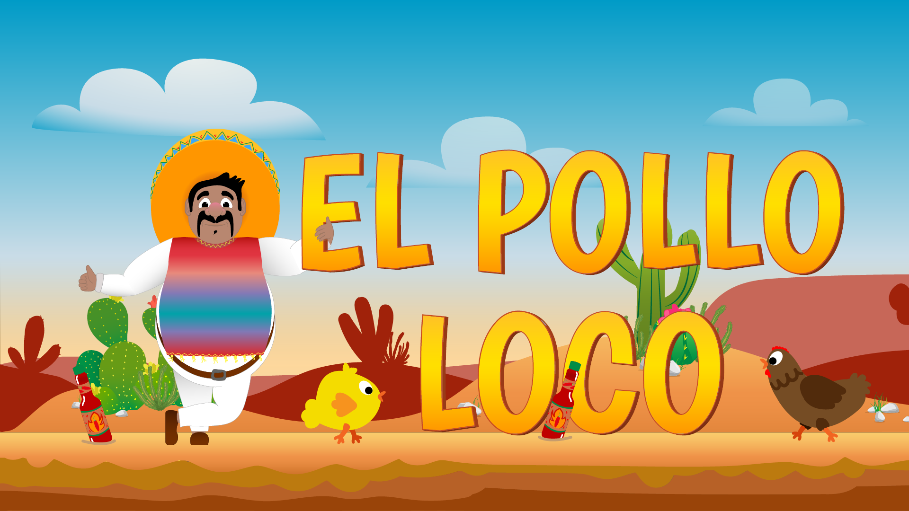

# El Pollo Loco

Ein 2D-Jump'n'Run-Browserspiel, objektorientiert in Vanilla JavaScript mit HTML5 Canvas umgesetzt.

Pepe muss sich durch die mexikanische Wüste kämpfen, Münzen und Salsa-Flaschen sammeln und am Ende die verrückte Riesenhenne besiegen.



## Features

- **Spielfigur mit allen Zuständen:** Laufen, Springen, Idle, Schlaf-Animation nach Inaktivität (inkl. Schnarchen), Verletzt und Tod
- **Zwei Gegnertypen:** normale Hühner und hüpfende Küken. Beide lassen sich durch Draufspringen oder mit Flaschen besiegen.
- **Endboss** mit eigener Lebensleiste sowie Alarm-, Lauf-, Angriffs-, Verletzt- und Todesanimation. Er bemerkt Pepe und verfolgt ihn.
- **Sammelobjekte:** Münzen in der Luft, Flaschen am Boden. Mit 5 Münzen lässt sich eine neue Flasche kaufen.
- **Wurf-Mechanik:** Flaschen fliegen aus Pepes Hand in Blickrichtung und zerplatzen mit Splash-Animation.
- **Sound:** Hintergrundmusik und Effekte über einen zentralen `SoundManager`. Stummschalten wirkt auf alle Sounds, die Einstellung wird im `localStorage` gespeichert.
- **Bedienung:** Startbildschirm, Anleitung mit Pause, Gewinn- und Game-Over-Bildschirm mit Neustart ohne Neuladen der Seite, Vollbildmodus
- **Mobile:** Touch-Steuerung, responsives Layout und Hinweis zum Drehen ins Querformat

## Steuerung

| Taste | Aktion |
| --- | --- |
| `←` `→` / `A` `D` | Laufen |
| `Leertaste` / `↑` | Springen |
| `F` | Flasche werfen |
| `V` | Flasche kaufen (5 Münzen) |
| `Esc` | Pause / Anleitung |

Auf Touch-Geräten erscheinen eigene Buttons am unteren Bildschirmrand.

## Technik

- HTML5 Canvas, CSS (Container Queries für die Skalierung der Overlays), Vanilla JavaScript (ES6-Klassen)
- Klassenhierarchie: `DrawableObject` → `MovableObject` → `Character`, `Enemy` (`Chicken`, `SmallChicken`, `Endboss`), `ThrowableObject`, `Coin`, `SalsaBottle`, …
- Alle Spiel-Intervalle laufen über `setStoppableInterval()` und lassen sich dadurch zentral pausieren und stoppen.
- Code-Dokumentation mit JSDoc (siehe Ordner `docs/`)

## Projektstruktur

```
index.html            Startseite mit Spiel
style.css             Basis-Styles (Schrift, Farben, Buttons, Seitenlayout)
css/                  game.css, mobile.css, legal.css
js/classes/           alle Klassen (*.class.js)
js/game.js            Spielablauf: Start, Pause, Neustart, Spielende
js/script.js          Bedienoberfläche: Bildschirme, Anleitung, Ton, Vollbild
js/controls.js        Tastatur- und Touch-Steuerung
levels/level1.js      Aufbau des Levels
img/, audio/, fonts/  Assets
docs/                 JSDoc-Dokumentation
```

## Lokal starten

Das Projekt kommt ohne Build-Schritt aus. Es genügt ein beliebiger lokaler Webserver, z.B.:

```bash
npx serve .
```

oder die VS-Code-Erweiterung „Live Server“. Danach `index.html` im Browser öffnen.

## Credits

- Grafiken: Developer Akademie
- Schriftart: [Boogaloo](https://fonts.google.com/specimen/Boogaloo) (SIL Open Font License, lokal eingebunden)
- Icons: [Material Icons](https://fonts.google.com/icons) (Apache License 2.0)
- Hintergrundmusik und Jingles: eigens für das Projekt erzeugt
